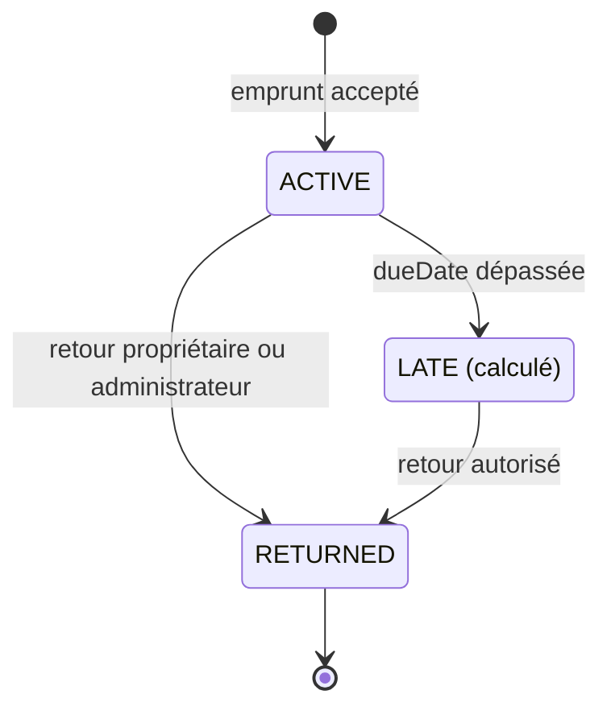

# Cycle de vie des emprunts

## Diagramme Mermaid

`LATE` n'est jamais stocké. Il est calculé par `getLoanStatus` à partir de `returnedAt`, `dueDate` et l'heure courante.

## Transition table

| Etat courant | Événement                      | Rôle         | Autorisé                                                         |   Code attendu | Cas            |
| ------------ | ------------------------------ | ------------ | ---------------------------------------------------------------- | -------------: | -------------- |
| Aucun        | emprunter                      | MEMBRE       | Oui si stock >0, moins de 3 prêts, pas de retard, pas de doublon |            201 | CT-08          |
| Aucun        | emprunter                      | ADMIN        | Non                                                              |            403 | CT-07, CT-22   |
| ACTIVE       | deuxième emprunt du même livre | MEMBRE       | Non                                                              |            409 | CT-14          |
| ACTIVE       | emprunter avec 3 prêts actifs  | MEMBRE       | Non                                                              |            403 | CT-24          |
| ACTIVE       | emprunter avec stock 0         | MEMBRE       | Non                                                              |            409 | CT-25          |
| ACTIVE/LATE  | emprunter avec prêt en retard  | MEMBRE       | Non                                                              |            403 | CT-26          |
| ACTIVE       | retour du propriétaire         | MEMBRE       | Oui                                                              |            200 | CT-15          |
| ACTIVE       | retour d'un autre membre       | MEMBRE       | Non                                                              |            404 | CT-16          |
| ACTIVE       | retour par admin               | ADMIN        | Oui                                                              |            200 | CT-23          |
| LATE         | retour du propriétaire         | MEMBRE       | Oui                                                              |            200 | CT-15          |
| RETURNED     | second retour                  | MEMBRE/ADMIN | Non                                                              |            404 | CT-21          |
| RETURNED     | prolongation                   | MEMBRE/ADMIN | Basse priorité                                                   | Hors périmètre | Hors périmètre |

## Matrice rôles × routes

| Route                     | Visiteur |      MEMBRE |   ADMIN |
| ------------------------- | -------: | ----------: | ------: |
| POST `/api/auth/register` |      201 |         201 |     201 |
| POST `/api/auth/login`    |      200 |         200 |     200 |
| POST `/api/auth/logout`   |      200 |         200 |     200 |
| GET `/api/books`          |      401 |         200 |     200 |
| POST `/api/books`         |      401 |         403 |     201 |
| PUT `/api/books/:id`      |      401 |         403 |     200 |
| DELETE `/api/books/:id`   |      401 |         403 | 200/409 |
| GET `/api/loans`          |      401 |         200 |     200 |
| POST `/api/loans`         |      401 | 201/409/403 |     403 |
| PATCH `/api/loans/:id`    |      401 |     200/404 | 200/404 |
| GET `/api/health`         |      200 |         200 |     200 |

Preuves réelles:

- Visiteur: `GET /api/loans` redirigé middleware HTTP `307` vers `/login`; `GET /api/health` HTTP `200`.
- Membre: `GET /api/books` HTTP `200`; `POST /api/books` HTTP `403`; emprunt stock zéro HTTP `409`.
- ADMIN: login HTTP `200`; création livre HTTP `201`; emprunt réel HTTP `403`.
